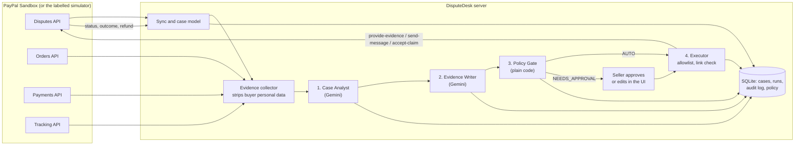

# DisputeDesk

**A dispute lawyer for every small seller, powered by PayPal and AI.**

DisputeDesk is an AI agent that defends small online sellers against PayPal disputes. When a buyer opens a case, it pulls the order, payment, shipment tracking and messages from PayPal, works out whether the case is worth fighting, drafts the response, and submits it through the PayPal Disputes API. Small, clear cases can be handled on their own within limits the seller sets. Everything else waits for one click of approval.

Everything runs on the **PayPal Sandbox**. No real money moves.

- Live demo: https://disputedesk-zcru.onrender.com (demo mode, simulated PayPal, real AI)
- Feasibility report from the real sandbox: [FEASIBILITY.md](FEASIBILITY.md)
- License: [MIT](LICENSE)

## The problem

A solo seller of handmade goods in Kuala Lumpur or Manila gets a dispute: "item not received". The parcel was delivered, the tracking proves it, but answering takes an hour of digging through emails, the courier site and PayPal's forms, in a second language, before a deadline. For a $30 order most sellers just give up and refund, even when they would have won. Dispute losses and the time spent on them come straight out of thin margins.

DisputeDesk does the digging and the writing, shows its reasoning, and lets the seller decide in seconds.

## Run it

You need Node.js 20.9 or newer.

### Demo mode, no accounts needed (one command)

```bash
npm install && npm run demo
```

Open http://localhost:3000. You get eight fictional cases for a small shop, a simulated PayPal that behaves like the real sandbox (measured in [FEASIBILITY.md](FEASIBILITY.md)), and a yellow striped banner so nobody mistakes it for real data. Without an AI key the agent uses simple, clearly labelled offline rules. Add a free Gemini key to see the real AI:

```bash
cp .env.example .env    # skip if you already have a .env, then set GEMINI_API_KEY (free at https://aistudio.google.com)
npm run demo
```

### With the real PayPal Sandbox

1. At [developer.paypal.com](https://developer.paypal.com), switch to **Sandbox** and create two sandbox accounts under **Sandbox Accounts**: a **US Business** account (the seller) and a **US Personal** account (the buyer). Use US accounts. A non-US seller leaves every payment stuck as "Unclaimed".
2. Under **Apps & Credentials**, create a **Merchant** app linked to the Business account. Make sure **Customer disputes**, **Transaction search** and **Invoicing** are ticked.
3. Copy `.env.example` to `.env` and fill in `PAYPAL_CLIENT_ID`, `PAYPAL_CLIENT_SECRET`, keep `PAYPAL_ENV=sandbox`, and add `GEMINI_API_KEY`.
4. Run `npm run dev` and open http://localhost:3000. The banner turns dark blue and says **PayPal Sandbox**.
5. Go to **Demo cases**, press **Create test orders**, approve each link as your sandbox buyer, press **Capture approved orders**, then open disputes as the buyer at sandbox.paypal.com. The page walks you through it.
6. Press **Sync from PayPal** on the Disputes page.

For a production build: `npm run go` (builds once, then starts).

### Tests

```bash
npm test
```

33 tests cover the Policy Gate, the rule that status only ever comes from PayPal, the Executor allowlist, prompt injection handling, personal data scrubbing (without destroying tracking numbers), citation checks and the simulator.

## How it works



1. **Case Analyst** (AI) reads the case and the numbered evidence, estimates the chance of winning, and recommends FIGHT, REFUND or ESCALATE with a plain explanation and a confidence score. Code then works out the expected value of fighting versus refunding using the seller's own numbers, shown as a balance scale.
2. **Evidence Writer** (AI) drafts the text to submit. Every claim must cite an evidence item. Code checks the citations and flags any claim with no evidence behind it. It never invents tracking numbers or facts, and says so when evidence is missing.
3. **Policy Gate** (plain code, not AI) checks the plan against the seller's policy: auto-act limit, minimum confidence, reasons never to act on alone, and whether PayPal offers the action right now. It answers AUTO, NEEDS_APPROVAL or BLOCKED, and lists every reason.
4. **Executor** is the only code that changes anything at PayPal. It fetches the dispute again, refuses if PayPal no longer offers the action, only sends actions from a fixed allowlist with payloads built in code, and stores PayPal's response exactly as received.

The case status the seller sees is computed from PayPal's data alone. "Won" needs PayPal's outcome. "Refunded" needs the refund resource to say COMPLETED. A 200 from an action only means "PayPal accepted the step", so the case shows "Processing at PayPal" until PayPal's own record changes.

## What is real vs simulated

| Part | Sandbox mode | Demo mode |
|---|---|---|
| Disputes, orders, payments, tracking, refunds | **Real** PayPal Sandbox REST APIs | **Simulated** by `SimulatedPayPalGateway`, labelled "Simulated" on every case |
| Opening a dispute | **Real**, but done by a person as the sandbox buyer in PayPal's Resolution Center. PayPal does not let a seller app open disputes | Seeded fictional cases |
| Submitting evidence, messages, accepting claims | **Real** API calls, responses stored verbatim | Simulated, with the same rules we measured (only evidence type OTHER is accepted, state changes take a few minutes) |
| Final decision on a fought case | **Sandbox adjudication**: a sandbox-only PayPal endpoint that stands in for PayPal's review. Labelled "Sandbox adjudication" everywhere. It does not exist in live PayPal | "Simulated PayPal decision" button, labelled |
| Money defended and refunded | Counted only from PayPal's outcome and refund records | Counted from the simulator, shown separately and labelled |
| AI reasoning and drafting | **Real** Google Gemini calls when `GEMINI_API_KEY` is set | Same |
| AI when no key is set | "Offline rules (no AI key)", simple transparent rules, labelled as not AI | Same |
| Hours saved | An estimate from the seller's policy settings, labelled as an estimate | Same |

## AI tools used, and how

- **Google Gemini** (`gemini-3.5-flash-lite`, falling back to `gemini-3.8-flash`) runs inside the product as the Case Analyst and Evidence Writer. It returns JSON constrained to a schema, which the app validates with zod before using. It never sees API secrets or the buyer's name, email, phone or address, and it cannot choose a PayPal action: the action comes from code and the live PayPal links.
- **Anthropic Claude** can be swapped in through the same provider interface (`AI_PROVIDER=anthropic`). It was not used for the demo.
- **Claude Code** (Anthropic's coding agent) helped build the project: it ran the sandbox feasibility probes, wrote most of the code and tests under the developer's direction, and drafted the documentation, which the developer reviewed.
- **PayPal Agent Toolkit** (`@paypal/agent-toolkit`) was evaluated in the feasibility phase. Its dispute tools cover list, get and accept claim only, so the app calls the Disputes REST API directly for evidence and messages. See [FEASIBILITY.md](FEASIBILITY.md).

## Responsible design

- **Status comes from PayPal, not from the AI.** The model can recommend and draft. It cannot mark anything as won or refunded.
- **Buyer messages are untrusted input.** They are wrapped in tags, the model is told they are claims to check, never instructions, and the gate holds any case where a buyer tried to instruct the agent. One demo case contains exactly that attack.
- **Personal data stays home.** Buyer names, emails, phone numbers and card-like numbers are removed before anything reaches the model. Tracking numbers are kept, because they are the evidence.
- **Secrets stay on the server.** Keys live in environment variables, are never logged, and never enter a prompt. The audit log strips anything that looks like a credential.
- **The seller is in charge.** The default policy only acts alone on small, clear cases, never on unauthorised-payment claims, and always lets the seller edit a draft before it is sent.
- **Everything is auditable.** Every agent decision, gate result and PayPal call is in the audit log, with PayPal's responses stored exactly as received.

## Limitations

- PayPal does not let a seller app open disputes, so sandbox cases have to be opened by hand as the buyer. The Demo cases page makes this quick, and demo mode needs none of it.
- The sandbox only accepts evidence type OTHER, so tracking facts travel in the notes. The typed `PROOF_OF_FULFILLMENT` path is kept behind the same code for live use.
- In the sandbox, the adjudication link appears 20 to 30 minutes after evidence is submitted. Until then a case honestly shows "Under review at PayPal".
- Evidence files (photos, receipts) are not uploaded yet, only text.
- The hosted demo's database resets when the free server restarts. It re-seeds itself.
- Gemini can be busy. Calls have a time budget, and when it runs out the agent falls back to the offline rules and says so on screen.

## Project layout

```
src/lib/paypal/      PayPal client (retries, redacted logging), sandbox and simulated gateways
src/lib/cases/       Case model, sync, status rules (PayPal data only)
src/lib/evidence/    Evidence collector and personal data scrubber
src/lib/agent/       Analyst, Writer, Policy Gate, Executor, pipeline, AI providers
src/lib/demo/        Demo seed and the sandbox test-order kit
src/app/             Next.js pages: Disputes, Case, Impact, Policy, Audit log, Demo cases
scripts/feasibility/ Phase 0 probes run against the real sandbox
tests/               Vitest suite
```

Built with Next.js, TypeScript, Tailwind CSS, SQLite (better-sqlite3 with Drizzle) and zod.
